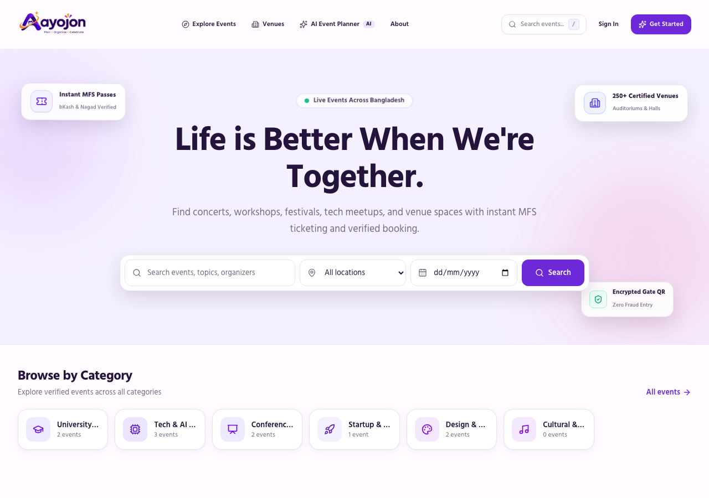
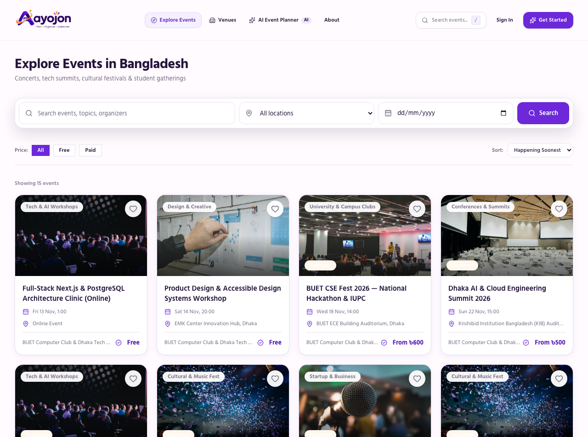
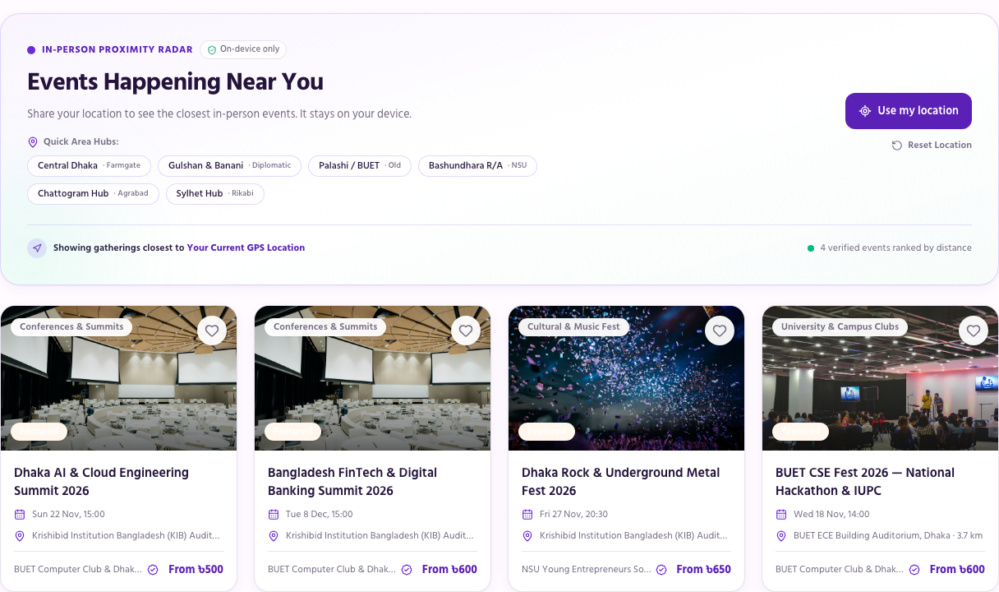
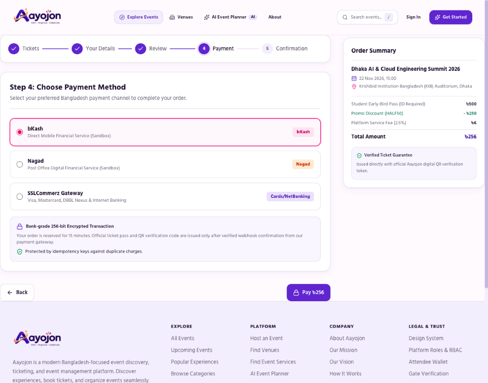
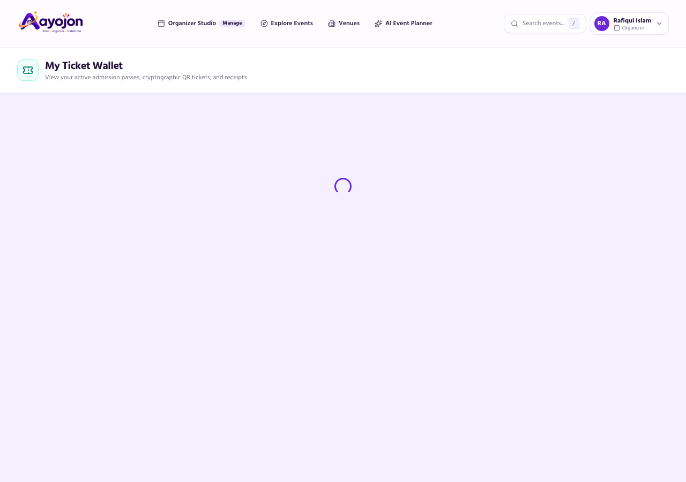
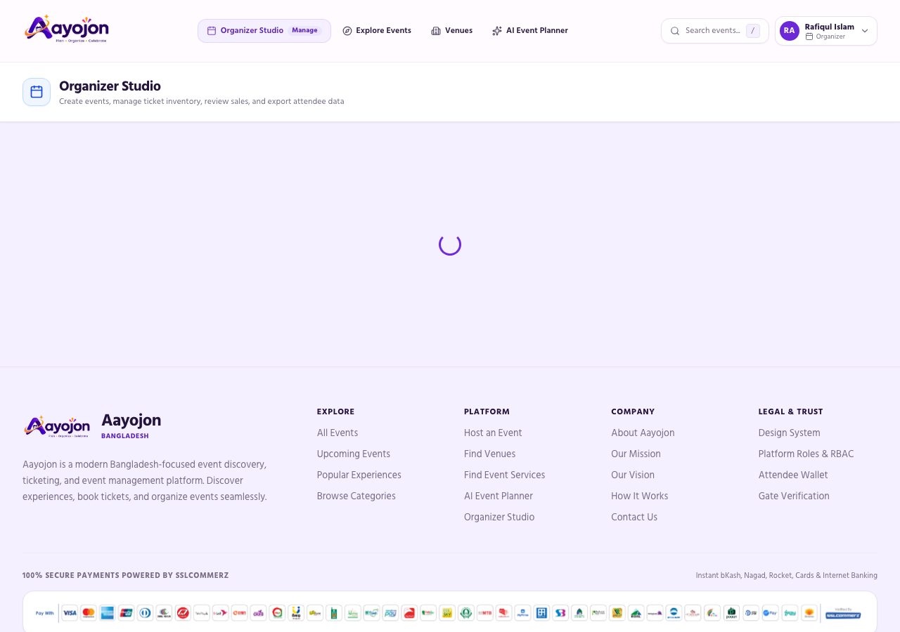

<div align="center">
  

  <h1>Aayojon (আয়োজন)</h1>
  <p><strong>All-in-One Event Discovery, Ticketing, Venue RFQ &amp; Management Platform for Bangladesh</strong></p>

  <p>
    <a href="https://react.dev/"></a>
    <a href="https://vitejs.dev/"></a>
    <a href="https://tailwindcss.com/"></a>
    <a href="https://firebase.google.com/"></a>
    <a href="tests/"></a>
  </p>
</div>

---

**Aayojon (আয়োজন)** is a full-stack event discovery, ticketing, promotion, and partner venue/services platform tailored for Bangladesh. It combines role-based workspaces, Firebase Authentication, admin-verified role onboarding, bKash/Nagad/SSLCommerz payment proof verification, and cryptographic QR gate check-in.

---

## 📸 Platform Screenshots

<table>
  <tr>
    <td width="50%" align="center">
      
      <br /><sub><strong>Home &amp; Event Discovery</strong> — Hero search, featured events, and category filters</sub>
    </td>
    <td width="50%" align="center">
      
      <br /><sub><strong>Events Catalog</strong> — Live inventory, pricing, and city/category filtering</sub>
    </td>
  </tr>
  <tr>
    <td width="50%" align="center">
      
      <br /><sub><strong>Near You Discovery</strong> — Device-only GPS &amp; area-hub distance sorting</sub>
    </td>
    <td width="50%" align="center">
      
      <br /><sub><strong>Authenticated Checkout</strong> — bKash, Nagad &amp; SSLCommerz payment verification</sub>
    </td>
  </tr>
  <tr>
    <td width="50%" align="center">
      
      <br /><sub><strong>Attendee QR Wallet</strong> — Digital passes, order history, and gate-ready QR codes</sub>
    </td>
    <td width="50%" align="center">
      
      <br /><sub><strong>Organizer Studio</strong> — Event builder, payment verification alerts &amp; attendee exports</sub>
    </td>
  </tr>
</table>

---

## 🌟 Key Capabilities

- **Unified Event Discovery**: Fast search, category filtering (Tech, Conferences, Workshops, Cultural Festivals, Competitions), GPS/hub proximity discovery, and live ticket inventory tracking.
- **Secure Authentication & Admin-Verified Role Onboarding**:
  - New accounts (via Google Sign-In or Email/Password) start strictly as **Attendee**.
  - Higher-authority positions (**Organizer**, **Venue Partner**, **Service Vendor**, **Corporate Sponsor**, **Gate Staff**) are applied for separately from **Profile** and require **Platform Admin** verification and approval.
- **Authenticated Checkout & Payment Verification Workflow**:
  - Checkout requires sign-in (`ProtectedRoute`) and validates Bangladeshi mobile numbers and unique `TrxID` references.
  - Submitted payments enter `AWAITING_VERIFICATION`, dispatching notifications to the **Event Organizer**, **Dedicated Staff**, and **Platform Admin** to accept & verify before cryptographic QR tickets are minted.
- **Gate Check-In & QR Scanner**: High-speed QR pass validation with camera support, offline verification, and double-scan replay prevention (`ALREADY_USED`).
- **Partner Venue & Services RFQ Marketplace**: Interactive venue catalog, multi-service Request For Quotation (RFQ) builder, itemized bidding comparison, and booking date locks.
- **AI Event Assistant**: Planning assistant for budget estimation, schedule synthesis, and vendor matching.

---

## 🏗️ Tech Stack

| Layer | Technology |
| :--- | :--- |
| **Frontend Framework** | [React 19](https://react.dev/) + TypeScript |
| **Build Tool & Dev Server** | [Vite 6](https://vitejs.dev/) |
| **Routing & Guards** | [React Router v7](https://reactrouter.com/) with `ProtectedRoute` RBAC enforcement |
| **Styling** | [Tailwind CSS 4](https://tailwindcss.com/) + Lucide Icons |
| **Authentication** | [Firebase Authentication v11](https://firebase.google.com/docs/auth) (with persisted local fallback) |
| **Database & Persistence** | [Cloud Firestore](https://firebase.google.com/docs/firestore) + local JSON/API fallback |
| **Testing Harness** | Custom TypeScript test runner covering **92 tests across 5 suites** |

---

## 🧭 Application Routes & Access Control

| Route | Access Control | Description |
| :--- | :--- | :--- |
| `/` | **Public** | Marketplace hero, featured events, categories, and discovery |
| `/events` | **Public** | Searchable event catalog with filters and proximity sorting |
| `/events/:slug` | **Public** | Event details, schedule, venue info, and ticket tiers |
| `/venues` | **Public** | Partner venue catalog with capacity and AV specifications |
| `/ai-event-assistant` | **Public** | AI event planning assistant for budget and schedule drafting |
| `/login` | **Public** | Sign In & Create Attendee Account (Google + Email/Password) |
| `/events/:slug/checkout` | **Authenticated** | Protected ticket checkout and payment proof submission |
| `/wallet` | **Attendee+** | Digital QR ticket wallet, booking history, and pass downloads |
| `/profile` | **Authenticated** | Personal profile management & elevated role application form |
| `/organizer` | **Organizer+** | Event creation, payment verification, publishing, and attendee roster |
| `/scanner` | **Staff+** | QR gate check-in scanner & dedicated staff payment verification |
| `/provider` | **Venue / Vendor** | Space/service inventory and RFQ quotation management |
| `/sponsor` | **Sponsor+** | Sponsorship opportunities and brand placement proposals |
| `/admin` | **Admin / Super Admin** | Event moderation, payment verifications, role applications, and audit logs |

---

## 🔥 Firebase & Environment Setup

1. Create a project in the [Firebase Console](https://console.firebase.google.com/) and register a **Web App**.
2. In **Authentication → Sign-in method**, enable **Email/Password** and **Google**.
3. Copy `.env.example` to `.env` and replace the placeholders with your own Firebase Web App config:

```bash
cp .env.example .env
```

```env
VITE_FIREBASE_API_KEY=<your-firebase-api-key>
VITE_FIREBASE_AUTH_DOMAIN=<your-project>.firebaseapp.com
VITE_FIREBASE_PROJECT_ID=<your-project-id>
VITE_FIREBASE_STORAGE_BUCKET=<your-project>.firebasestorage.app
VITE_FIREBASE_MESSAGING_SENDER_ID=<your-messaging-sender-id>
VITE_FIREBASE_APP_ID=<your-firebase-app-id>
VITE_FIREBASE_MEASUREMENT_ID=<your-measurement-id>
```

> **Note**: Never commit `.env` or real service credentials. If `.env` is omitted, Aayojon automatically uses its local credential store for offline development and testing.

### (Optional) Deploy Firestore Security Rules
Security rules are defined in [`firestore.rules`](firestore.rules):

```bash
firebase deploy --only firestore:rules
```

---

## 🚀 Getting Started

### Prerequisites
- Node.js >= 18.0.0
- npm >= 9.0.0

### Installation & Local Development

```bash
git clone https://github.com/sameul-hasan/ayojon.git
cd ayojon
npm install
npm run dev
```

### Typecheck, Build & Preview

```bash
npx tsc --noEmit
npm run build
npm run preview
```

---

## 🧪 Automated Testing

Run all 5 verification suites (**92 test cases**):

```bash
npm test
```

1. **Domain QA Invariants (14 tests)** — Draft/publish payment guards, webhook idempotency, atomic ticket inventory, QR replay protection, and multi-tenant isolation.
2. **Firebase Authentication & Middleware (8 tests)** — Sign-up, sign-in, session persistence, role mapping, and `withAuth` token checks.
3. **Venue & Services Marketplace (8 tests)** — Venue specs, multi-step RFQ creation, itemized quotations, revisions, and escrow booking locks.
4. **Centralized RBAC Security Suite (15 tests)** — Route/resource isolation, role self-escalation prevention, and suspended account blocks.
5. **Persona Matrix & Behavioral E2E Suite (47 tests)** — End-to-end guest, attendee, organizer, gate staff, venue/vendor, sponsor, admin, payment, and UX flows.

---

## 📁 Repository Structure

```text
ayojon/
├── .env.example                # Sample environment template (no secrets)
├── firestore.rules             # Cloud Firestore security rules
├── package.json                # Dependencies and scripts
├── vite.config.ts              # Vite configuration & dev API middleware
├── docs/screenshots/           # Platform screenshots for documentation
├── public/                     # Static assets & brand logos
├── data/                       # Seed/local application database
├── src/
│   ├── App.tsx                 # Central router & RBAC route guards
│   ├── components/             # Modular UI components by domain
│   ├── hooks/                  # Permission & UI hooks
│   ├── lib/                    # Firebase client, RBAC, client-api & domain logic
│   ├── pages/                  # Route page components
│   ├── server/                 # Vite dev API middleware
│   └── styles/                 # Tailwind CSS styles
└── tests/                      # Automated 5-suite test runner
```

---

## 📜 License

Copyright © 2026 Aayojon Platform. All rights reserved.
